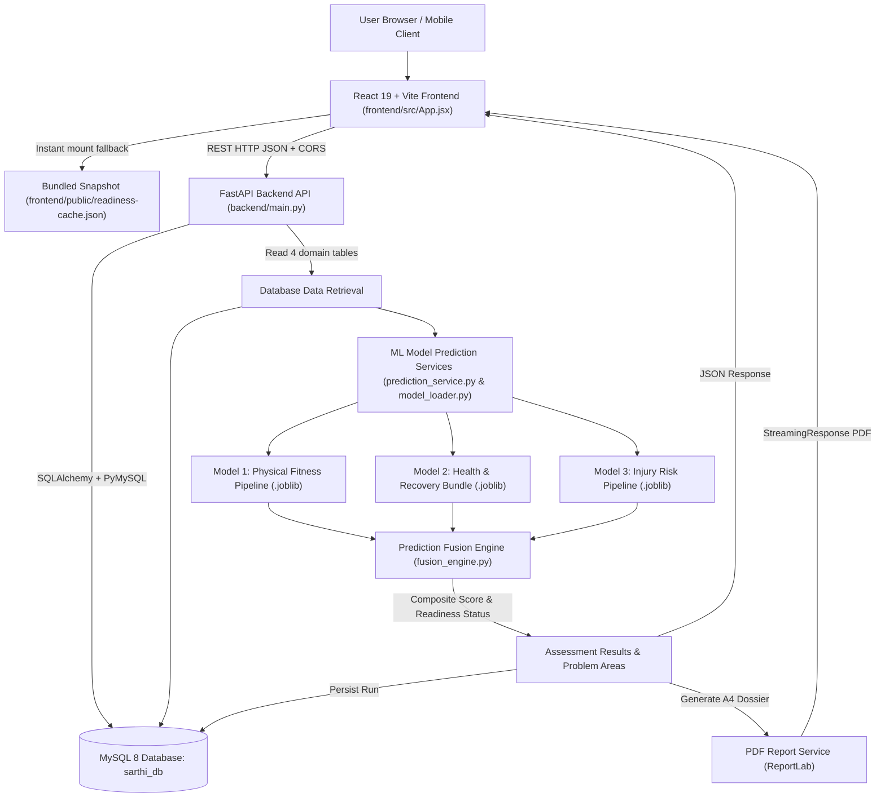

# S.A.R.T.H.I. — Soldier Assessment, Readiness, Training & Health Intelligence

> **Academic Research & Decision-Support System** (displayed in the command portal and PDF dossiers as *Soldier AI Readiness, Tracking, Health & Intelligence*)

[](#technology-stack)
[](#technology-stack)
[](#database-architecture)
[](#machine-learning-architecture)

---

## Table of Contents

1. [Project Overview](#1-project-overview)
2. [Project Objectives](#2-project-objectives)
3. [Key Features](#3-key-features)
4. [Technology Stack](#4-technology-stack)
5. [Complete System Architecture](#5-complete-system-architecture)
6. [Architecture Diagram](#6-architecture-diagram)
7. [Detailed Data Flow](#7-detailed-data-flow)
8. [Frontend Architecture](#8-frontend-architecture)
9. [Backend Architecture](#9-backend-architecture)
10. [Database Architecture](#10-database-architecture)
11. [Machine Learning Architecture](#11-machine-learning-architecture)
12. [Model Descriptions](#12-model-descriptions)
13. [Prediction & Fusion Workflow](#13-prediction--fusion-workflow)
14. [API Endpoint Documentation](#14-api-endpoint-documentation)
15. [Project Folder Structure](#15-project-folder-structure)
16. [Installation Instructions](#16-installation-instructions)
17. [Environment Variable Configuration](#17-environment-variable-configuration)
18. [Backend Setup & Execution](#18-backend-setup--execution)
19. [Frontend Setup & Execution](#19-frontend-setup--execution)
20. [Database Setup](#20-database-setup)
21. [Deployment Instructions](#21-deployment-instructions)
22. [Troubleshooting](#22-troubleshooting)
23. [Future Scope](#23-future-scope)

---

## 1. Project Overview

**S.A.R.T.H.I.** is a full-stack multi-modal machine learning analytics and command dashboard built for evaluating personnel physical fitness, autonomic health & recovery, musculoskeletal injury probability, and composite combat readiness across a 2,000-soldier synthetic research battalion (`SARTHI-0001` through `SARTHI-2000`).

The platform pairs three serialized `scikit-learn` pipelines (`LinearRegression` and balanced `LogisticRegression`) inside a weighted **Prediction Fusion Engine** with a **FastAPI** backend, a relational **MySQL** store, server-side **ReportLab PDF dossier generation**, and a **React + Vite** command dashboard featuring a cache-first offline/cross-device fallback snapshot (`readiness-cache.json`).

---

## 2. Project Objectives

- Centralize per-soldier physical testing, wearable recovery biometrics, and training/injury telemetry into a unified relational schema.
- Execute three domain-specific ML models consistently through validated preprocessing pipelines without feature drift or missing/unexpected key leakage.
- Synthesize individual model outputs into an interpretable `0–100` composite readiness index enforced by a strict injury-risk safety override.
- Surface actionable rule-based physiological alerts (*Problem Areas*), longitudinal prediction history, and downloadable 9-section A4 assessment reports.
- Maintain responsive cross-device availability on deployed static hosting even when a local/private backend instance is offline.

---

## 3. Key Features

- **Multi-Model ML Fusion Engine:** Combines Model 1 (Physical Fitness `0–100`), Model 2 (Health & Recovery `0–10`), and Model 3 (Injury Risk Probability `0–100%` + `'Yes'/'No'` class) into four readiness tiers.
- **2,000-Soldier Interactive Roster (`Fit / Unfit Soldiers`):** Filter by readiness category (`Fit`, `Conditionally Ready`, `Unfit`), gender, age bracket (`<28`, `28–34`, `35+`), free-text search, and 6 sort criteria.
- **Soldier ID Search (`SARTHI-0000`–`SARTHI-2000`):** Fast numeric lookup normalizing input into padded `SARTHI-XXXX` IDs.
- **Hybrid Online + Standalone Cache Architecture:** Loads `frontend/public/readiness-cache.json` immediately on mount and transparently upgrades to live FastAPI inference when `/health` responds.
- **Automated Problem-Area Flags:** Highlights elevated injury risk (`Yes` or `>= 50%`), low predicted fitness (`< 50`), high stress (`>= 7`), and reduced sleep quality (`<= 6`).
- **9-Section A4 PDF Dossier Export:** Server-generated ReportLab PDF (`GET /soldiers/{soldier_id}/report`) with an offline printable modal (`window.print()`) fallback.
- **Tactical UI Controls:** Animated SVG Indian Army hologram boot screen, Dark Olive Camo / Stealth Black Dark Mode toggle, interactive cursor parallax + sidebar `GRID TRACK`, and persistent `Small` / `Default` / `Large` font scaling (`localStorage`).

---

## 4. Technology Stack

| Layer | Technologies Used (Verified from Source) |
| :--- | :--- |
| **Frontend** | React `19.3.1`, Vite `8.3.6`, Tailwind CSS `4.3.5` (`@tailwindcss/vite`), `lucide-react` `1.77.0`, native `fetch` + `AbortController` (`axios`, `react-router-dom`, `recharts` are present in `frontend/package.json`) |
| **Backend API** | FastAPI `0.163.1`, Uvicorn `0.54.0`, Pydantic `2.14.3`, `python-dotenv` `1.2.4` |
| **Database & ORM** | MySQL 8 (`sarthi_db`), SQLAlchemy `2.1.9`, PyMySQL `1.2.4` |
| **Machine Learning** | `scikit-learn` `1.9.0`, `joblib` `1.6.0`, `pandas` `3.1.1`, `numpy` `2.5.5`, `scipy` `1.18.1` |
| **PDF Reporting** | ReportLab `5.1.0` |
| **Hosting Configs** | Netlify (`frontend/netlify.toml`), Vercel (`frontend/vercel.json`), Procfile hosts (`backend/Procfile`) |

---

## 5. Complete System Architecture

S.A.R.T.H.I. separates static UI delivery from ML/database compute while ensuring continuity via a bundled dataset snapshot. Detailed architectural documentation, ER diagrams, and UI state breakdowns are available in [docs/ARCHITECTURE.md](docs/ARCHITECTURE.md).

- **Client Layer (`frontend/`):** Renders the command portal, reads `/readiness-cache.json` immediately, probes `/health`, and queries `/readiness-directory` or `/dashboard/{soldier_id}` when FastAPI is online.
- **API Layer (`backend/main.py`):** Exposes 10 REST endpoints with CORS policy management, Pydantic strict payload validation, SQLAlchemy session dependency injection, and ReportLab PDF streaming.
- **Database Layer (`backend/database.py`):** Connects to MySQL via `mysql+pymysql` with `pool_pre_ping=True`, storing 4 input/master tables and 1 longitudinal prediction table.
- **ML & Fusion Layer (`backend/services/`):** Caches `.joblib` pipelines in a module singleton, validates feature schemas/finiteness, executes all three models, and computes weighted readiness + safety overrides.

---

## 6. Architecture Diagram



### Architecture Explanation

1. **Frontend -> Backend API:** The React SPA probes `GET /health`. If online, it loads live battalion and soldier assessments from `GET /readiness-directory` and `GET /dashboard/{soldier_id}`; if offline, it renders directly from `/readiness-cache.json`.
2. **Backend API -> Database / Data Retrieval:** SQLAlchemy fetches matching `Soldier_ID` records across `soldiers`, `physical_fitness`, `health_recovery`, and `injury_records` (popping dataset ground-truth outcome columns before inference).
3. **ML Model Prediction Services:** `model_loader.py` keeps Models 1, 2, and 3 cached in memory. `prediction_service.py` enforces exact feature sets, finite numbers, and boolean parsing for `Rope_Climbing_Completed`.
4. **Prediction Fusion Engine -> Assessment Results:** `fusion_engine.py` normalizes scores to `0–100`, applies the `40% / 30% / 30%` weighted formula and `>= 50%` / `"Yes"` injury safety override, and returns structured readiness telemetry.
5. **Frontend Dashboard / Reports:** Results populate Overview, Roster, Pillar tabs, longitudinal Prediction History, and downloadable A4 ReportLab PDFs (`GET /soldiers/{soldier_id}/report`).

---

## 7. Detailed Data Flow

1. **Startup Hydration:** Browser loads `App.jsx`, parses `/readiness-cache.json` into `recordsMap` (indexed by `SARTHI-XXXX`), and shows `CACHE READY`.
2. **Live Sync:** `App.jsx` calls `GET {VITE_API_URL}/health` (`2.5s` timeout). On HTTP `200`, status becomes `ONLINE` and `GET /readiness-directory` refreshes all 2,000 dossiers with live FastAPI Fusion Engine results.
3. **Soldier Inspection (`GET /dashboard/{soldier_id}`):**
   - Queries `soldiers`, `physical_fitness`, `health_recovery`, `injury_records`, and `prediction_history`.
   - Extracts ground-truth `Injury_Occurred`, `Injury_Type`, `Injury_Body_Part`, and `Injury_Severity` into `historical_injury_outcome`.
   - Passes the 11, 7, and 23 required features into `run_fusion_engine()`.
   - Evaluates threshold rules (`Injury Risk`, `Physical Fitness < 50`, `Stress Level >= 7`, `Quality of Sleep <= 6`) to construct `problem_areas`.
4. **On-Demand Prediction Persistence (`POST /predict/soldier/{soldier_id}`):** Runs the same Fusion Engine pipeline and commits `(Soldier_ID, Model_1_Prediction, Model_2_Prediction, Model_3_Prediction)` into `prediction_history`.
5. **PDF Export (`GET /soldiers/{soldier_id}/report`):** Calls `get_soldier_dashboard()` -> `generate_soldier_report()` -> streams `SARTHI_{soldier_id}_Report.pdf`.

---

## 8. Frontend Architecture

Implemented in [frontend/src/App.jsx](frontend/src/App.jsx), [frontend/src/index.css](frontend/src/index.css), and [frontend/index.html](frontend/index.html):

- **Single-Page State Navigation:** Uses `activeNav` state across 6 modules (`Overview`, `Fit / Unfit Soldiers`, `Physical Fitness`, `Health & Recovery`, `Injury Risk & History`, `Settings & Info`).
- **Soldier Payload Normalizer (`normalizeSoldierPayload`):** Unifies responses from both `/readiness-directory` / `readiness-cache.json` and `/dashboard/{soldier_id}` into a consistent client view model, normalizing genders, numeric fields, prediction timestamps, and severity badges.
- **Persistent User Preferences:** Theme mode (`Dark Olive Green Camo` vs. `Stealth Black Dark Mode`) and root font scale (`Small` `14px`, `Default` `16px`, `Large` `18px` stored under `localStorage['sarthi_font_size']`).
- **Offline Print Fallback:** Opens a formatted official dossier modal wired to `window.print()` whenever the FastAPI server is offline.

---

## 9. Backend Architecture

Implemented across [backend/main.py](backend/main.py), [backend/database.py](backend/database.py), and [backend/services/](backend/services):

- **FastAPI App & CORS (`main.py`):** Configures `CORSMiddleware` for Vite dev origins (`localhost:5173/5174`), preset Netlify URLs, and comma-separated `ALLOWED_ORIGINS`.
- **Input Validation & Security:**
  - *Authentication:* No user authentication or token/JWT scheme is implemented; endpoints are designed for direct dashboard/CORS consumption.
  - *Validation:* `FusionRequest` enforces `ConfigDict(extra="forbid")` and dictionary key validation; `prediction_service.py` enforces exact feature matching, non-bool numeric types, and `math.isfinite()`; SQL uses bound parameters with hardcoded table whitelists.
- **Report Service (`services/pdf_report_service.py`):** Builds multi-page A4 PDFs with styled ReportLab tables, XML-escaped field values (`safe()`), page footers (`S.A.R.T.H.I. | Synthetic Research Simulation`), and mandatory limitation disclaimers.

---

## 10. Database Architecture

MySQL 8 (`sarthi_db`, `InnoDB`, `utf8mb4`) contains five tables linked by `Soldier_ID`:

| Table | Primary Key | Foreign Key | Purpose |
| :--- | :--- | :--- | :--- |
| `soldiers` | `Soldier_ID` (`varchar(50)`) | — | Master personnel roster (`Soldier_Name`, `Rank`, `Gender`, `Age`) |
| `physical_fitness` | `Soldier_ID` | `fk_physical_soldier` -> `soldiers` | BPT times/distance, rope climbing, pushups, pullups, situps, plank, HR metrics, dataset score/status |
| `health_recovery` | `Soldier_ID` | `fk_health_soldier` -> `soldiers` | Sleep duration/quality, activity level, stress, BMI category, BP, HR, daily steps, sleep disorder |
| `injury_records` | `Soldier_ID` | `fk_injury_soldier` -> `soldiers` | Anthropometrics, service years, running/marching/load metrics, medical history, pain, historical outcomes |
| `prediction_history` | `Prediction_ID` (`bigint AUTO_INCREMENT`) | `fk_prediction_soldier` -> `soldiers` | Stores `Model_1_Prediction`, `Model_2_Prediction`, `Model_3_Prediction`, and `Prediction_Timestamp` |

Full column definitions are documented in the ER diagram in [docs/ARCHITECTURE.md](docs/ARCHITECTURE.md#23-database-layer-backenddatabasepy--mysql-sarthi_db).

---

## 11. Machine Learning Architecture

- **Artifact Directory:** Active production models reside in [backend/models/](backend/models) (`Model_1/`, `Model_2/`, `Model_3/`) and are mirrored in top-level `models/`.
- **Lazy Loading (`services/model_loader.py`):** Loads all 3 `.joblib` artifacts once into `_MODELS` and verifies `.predict()` availability before serving any inference request.
- **Diagnostics Tooling:** [backend/services/model_inspection.py](backend/services/model_inspection.py) can be executed directly (`python backend/services/model_inspection.py`) to inspect estimator types, feature names, pipeline steps, classes, and stored test metrics.

---

## 12. Model Descriptions

Inspected directly from the serialized `.joblib` models (all trained with `scikit-learn 1.9.0`):

1. **Model 1 — Physical Fitness (`backend/models/Model_1/sarthi_model1_physical_fitness_v1.joblib`)**
   - **Type:** `Pipeline(ColumnTransformer -> LinearRegression)`
   - **Preprocessing:** `StandardScaler` on 10 numeric features + `passthrough` on `Rope_Climbing_Completed`
   - **Inputs (11):** `Age`, `BPT_Distance_km`, `BPT_Time_Minutes`, `Rope_Climbing_Completed`, `Rope_Climbing_Time_Seconds`, `Pushups_Count`, `Pullups_Count`, `Situps_Count`, `Plank_Time_Seconds`, `Resting_Heart_Rate_bpm`, `Recovery_Heart_Rate_bpm`
   - **Output:** Predicted Physical Fitness Score (`0–100`)

2. **Model 2 — Health & Recovery (`backend/models/Model_2/sarthi_model2_fitness_regression.joblib`)**
   - **Type:** Dictionary bundle containing `LinearRegression` (`target="Fitness_Score_Recalculated"`)
   - **Stored Test Metrics:** `R² = 0.999994`, `MAE = 0.00246`, `RMSE = 0.00286`
   - **Inputs (7):** `Age`, `Sleep Duration`, `Quality of Sleep`, `Physical Activity Level`, `Stress Level`, `Heart Rate`, `Daily Steps`
   - **Output:** Predicted Health & Recovery Score (`0–10`, tagged *Experimental - Not Clinically Validated*)

3. **Model 3 — Injury Risk (`backend/models/Model_3/sarthi_model3_injury_risk.joblib`)**
   - **Type:** `Pipeline(ColumnTransformer -> LogisticRegression(class_weight="balanced", max_iter=2000, random_state=42))`
   - **Preprocessing:** Numeric (`SimpleImputer(strategy="median")` + `StandardScaler`, 14 cols) and Categorical (`SimpleImputer(strategy="most_frequent")` + `OneHotEncoder(handle_unknown="ignore")`, 9 cols)
   - **Inputs (23):** `Age`, `Height_cm`, `Weight_kg`, `BMI`, `Service_Years`, `Running_Distance_km`, `Running_Days_Per_Week`, `Marching_Distance_km`, `Training_Hours_Per_Week`, `Load_Carried_kg`, `Previous_Injury_Count`, `Rest_Days_Per_Week`, `Sleep_Hours`, `Current_Pain`, `Rank`, `Gender`, `Training_Type`, `Previous_Injury`, `Previous_Injury_Type`, `Fitness_Level`, `Terrain`, `Pain_Body_Part`, `Medical_History`
   - **Output:** Binary classification (`"No"` / `"Yes"`) and `"Yes"` class probability (`0–100%`)

---

## 13. Prediction & Fusion Workflow

Implemented in [backend/services/fusion_engine.py](backend/services/fusion_engine.py):

1. Execute Models 1, 2, and 3 via `_run_model` exception wrappers.
2. When all three succeed (`successful_models == 3`):
   - Validate finite outputs within ranges: Physical `[0, 100]`, Health `[0, 10]`, Injury Probability `[0, 100]`.
   - Normalize Health Score: $\text{Normalized Health} = \text{Model 2 Score} \times 10$.
   - Invert Injury Risk to Safety: $\text{Injury Safety} = 100 - \text{Injury Probability}$.
   - Compute weighted composite index (rounded to 2 decimal places):

$$\text{Readiness Score} = 0.40 \times \text{Physical} + 0.30 \times \text{Normalized Health} + 0.30 \times \text{Injury Safety}$$

3. **Classification Logic (Safety Override Applied First):**
   - If `predicted_injury == "Yes"` **or** `injury_probability >= 50` -> **`Not Combat Ready - Injury Risk Flagged`**
   - Else if `readiness_score >= 80` -> **`Combat Ready`**
   - Else if `readiness_score >= 60` -> **`Conditionally Ready`**
   - Else -> **`Not Combat Ready`**

---

## 14. API Endpoint Documentation

| Method | Endpoint | Summary |
| :--- | :--- | :--- |
| `GET` | `/` | Service welcome banner and running status |
| `GET` | `/health` | Database connectivity (`SELECT 1`) check |
| `GET` | `/readiness-directory` | All 2,000 soldiers scored via live Fusion Engine + battalion summary |
| `GET` | `/soldiers/{soldier_id}` | Soldier demographic profile (`Soldier_ID`, Name, Rank, Gender, Age) |
| `GET` | `/soldiers/{soldier_id}/complete-profile` | Complete rows across physical, health, and injury tables |
| `POST` | `/predict/soldier/{soldier_id}` | Runs Fusion Engine from DB records and saves to `prediction_history` |
| `GET` | `/prediction-history/{soldier_id}` | Historical predictions ordered newest first |
| `GET` | `/dashboard/{soldier_id}` | Unified dashboard response, separated historical outcome, and problem areas |
| `GET` | `/soldiers/{soldier_id}/report` | Generates and downloads 9-section A4 ReportLab PDF |
| `POST` | `/predict/fusion` | Runs stateless Fusion Engine from supplied `FusionRequest` JSON |

Full request/response schemas and `curl` examples are in [docs/API_DOCUMENTATION.md](docs/API_DOCUMENTATION.md).

---

## 15. Project Folder Structure

```text
S.A.R.T.H.I/
├── .gitignore
├── README.md
├── all_soldiers_readiness.csv              # 2,000-row exported battalion readiness dataset
├── backend/
│   ├── .env.example                        # Backend MySQL & CORS environment template
│   ├── Procfile                            # Process startup command for PaaS hosts
│   ├── requirements.txt                    # Direct Python third-party dependencies
│   ├── database.py                         # SQLAlchemy + PyMySQL engine & session dependency
│   ├── main.py                             # FastAPI application, CORS, and all 10 routes
│   ├── inspect_data_sources.py             # CLI helper for inspecting source CSV/XLSX datasets
│   ├── verify_soldier_ids.py               # CLI helper verifying ID consistency across datasets
│   ├── models/
│   │   ├── Model_1/
│   │   │   └── sarthi_model1_physical_fitness_v1.joblib
│   │   ├── Model_2/
│   │   │   └── sarthi_model2_fitness_regression.joblib
│   │   └── Model_3/
│   │       └── sarthi_model3_injury_risk.joblib
│   └── services/
│       ├── fusion_engine.py                # 40/30/30 Fusion Engine & injury safety override
│       ├── model_inspection.py             # Script to inspect .joblib models and metrics
│       ├── model_loader.py                 # Singleton loader validating ML artifacts
│       ├── pdf_report_service.py           # ReportLab A4 9-section PDF builder
│       └── prediction_service.py           # Input schema checks & model inference wrappers
├── docs/
│   ├── API_DOCUMENTATION.md                # Full REST API schemas and examples
│   ├── ARCHITECTURE.md                     # Deep system, ER, and ML pipeline diagrams
│   └── DEPLOYMENT.md                       # Netlify, Vercel, Render/Railway & MySQL deploy guide
├── frontend/
│   ├── .env.example                        # Frontend VITE_API_URL template
│   ├── .gitignore
│   ├── index.html
│   ├── netlify.toml                        # Netlify build & SPA redirect rules
│   ├── package.json                        # React 19, Vite 8, Tailwind CSS v4 dependencies
│   ├── vercel.json                         # Vercel SPA rewrite rules
│   ├── vite.config.js                      # Vite React + Tailwind plugin config
│   ├── public/
│   │   ├── favicon.svg
│   │   ├── icons.svg
│   │   └── readiness-cache.json            # 2,000-soldier standalone fallback snapshot
│   └── src/
│       ├── App.jsx                         # Main dashboard SPA and hybrid cache/API client
│       ├── index.css                       # Global Tailwind v4 stylesheet
│       └── main.jsx                        # React entry mount
└── models/                                 # Top-level backup/copy of trained .joblib models
```

---

## 16. Installation Instructions

### Prerequisites

- **Python:** 3.10+ (tested on Python 3.14 inside `backend/venv`)
- **Node.js & npm:** Node.js 18+ / 20+
- **MySQL Server:** MySQL 8.0+ (optional if running frontend strictly in `CACHE READY` standalone mode, required for live FastAPI backend)

---

## 17. Environment Variable Configuration

### Backend (`backend/.env`)

Copy [backend/.env.example](backend/.env.example) to `backend/.env` and populate your local/production values:

```env
DB_HOST=localhost
DB_PORT=3306
DB_NAME=sarthi_db
DB_USER=root
DB_PASSWORD=your_mysql_password
ALLOWED_ORIGINS=https://your-frontend.netlify.app,https://your-frontend.vercel.app
```

> Never commit `backend/.env`. `backend/database.py` exits with a `ValueError` at startup if `DB_HOST`, `DB_NAME`, `DB_USER`, or `DB_PASSWORD` are missing.

### Frontend (`frontend/.env`)

Copy [frontend/.env.example](frontend/.env.example) to `frontend/.env` if targeting a non-local backend:

```env
VITE_API_URL=http://127.0.0.1:8000
```

---

## 18. Backend Setup & Execution

```bash
cd backend
python -m venv venv

# Activate virtual environment
# Windows (PowerShell):
.\venv\Scripts\Activate.ps1
# macOS / Linux:
# source venv/bin/activate

pip install -r requirements.txt

# Verify ML models load cleanly
python services/model_inspection.py

# Start FastAPI server
uvicorn main:app --reload --host 127.0.0.1 --port 8000
```

Once running, interactive OpenAPI docs are available at `http://127.0.0.1:8000/docs`.

---

## 19. Frontend Setup & Execution

```bash
cd frontend
npm install
npm run dev
```

Open the URL printed by Vite (default `http://localhost:5173`).

To produce a production static bundle (`frontend/dist`):

```bash
cd frontend
npm run build
```

---

## 20. Database Setup

1. Create the target database in MySQL 8:
   ```sql
   CREATE DATABASE IF NOT EXISTS sarthi_db CHARACTER SET utf8mb4 COLLATE utf8mb4_0900_ai_ci;
   ```
2. Import your database dump (`sarthi_db_deploy.sql` or equivalent schema/seed dump) using UTF-8:
   ```bash
   mysql --default-character-set=utf8mb4 -u root -p sarthi_db < sarthi_db_deploy.sql
   ```
3. Confirm `GET http://127.0.0.1:8000/health` returns `{"status": "Healthy", "backend": "Operational", "database": "Connected"}`.

---

## 21. Deployment Instructions

Deployment manifests are pre-configured in:
- [frontend/netlify.toml](frontend/netlify.toml) (`command = "npm run build"`, `publish = "dist"`, SPA fallback `/* -> /index.html`)
- [frontend/vercel.json](frontend/vercel.json) (SPA rewrite)
- [backend/Procfile](backend/Procfile) (`web: uvicorn main:app --host 0.0.0.0 --port ${PORT:-8000}`)

**Quick Summary:**
1. Host MySQL 8 and import the `sarthi_db` dump using `--default-character-set=utf8mb4`.
2. Deploy `backend/` to a Python host (Render/Railway), set `DB_HOST`, `DB_PORT`, `DB_NAME`, `DB_USER`, `DB_PASSWORD`, and `ALLOWED_ORIGINS`.
3. Deploy `frontend/` to Netlify (`netlify deploy --prod --dir=dist`) or Vercel, optionally setting `VITE_API_URL` to the hosted backend URL. Even without a live backend, `frontend/public/readiness-cache.json` enables cross-device roster browsing and dossier inspection.

See [docs/DEPLOYMENT.md](docs/DEPLOYMENT.md) for step-by-step instructions.

---

## 22. Troubleshooting

| Symptom | Cause | Resolution |
| :--- | :--- | :--- |
| `ValueError: Database configuration missing in .env file` | Missing `backend/.env` or unset `DB_*` variables | Create `backend/.env` from `backend/.env.example` with non-empty `DB_HOST`, `DB_NAME`, `DB_USER`, `DB_PASSWORD`. |
| `GET /health` returns `"database": "Disconnected"` | MySQL service stopped, wrong credentials, or `sarthi_db` missing | Start MySQL, verify `DB_USER`/`DB_PASSWORD`/`DB_PORT`, and confirm `sarthi_db` exists. |
| Frontend displays `CACHE READY` instead of `ONLINE` | `VITE_API_URL` backend is offline or blocked by CORS | Start Uvicorn locally (or check hosted backend `/health`) and verify the frontend domain is listed in `ALLOWED_ORIGINS`. |
| `joblib.load` or sklearn unpickling warnings/errors | `scikit-learn` version mismatch | Install pinned dependencies from `backend/requirements.txt` (`scikit-learn==1.9.0`, `numpy==2.5.5`). |
| SQL import fails with `ERROR` / garbled characters on Windows | Dump saved with PowerShell `>` (UTF-16LE BOM) | Export with `mysqldump ... --result-file=dump.sql` and import with `--default-character-set=utf8mb4`. |
| Deployed `PDF Report` opens Print Preview modal instead of downloading `.pdf` | Server ReportLab endpoint unreachable in standalone cache mode | Intended graceful fallback (`window.print()`). Start/connect the FastAPI backend to download server-generated ReportLab PDFs. |

---

## 23. Future Scope

Based directly on existing packages and architecture placeholders observed in the repository:
- **Interactive Analytics Charts:** `recharts` is already declared in `frontend/package.json` and can be wired into longitudinal `prediction_history` trends and battalion readiness distributions.
- **Multi-View Routing:** `react-router-dom` and `axios` are already present in `frontend/package.json` to support deep-linked URL routes (e.g., `/soldier/:id`) and centralized API interceptors.
- **Persistent Batch & Individual Inference UI:** `POST /predict/soldier/{soldier_id}` and `POST /predict/fusion` already exist on the backend and can be exposed via an interactive "What-If / Re-Evaluate" UI form to run live simulations and persist new rows into `prediction_history`.
- **Activity Recognition Expansion:** An unused model artifact (`backend/models/Model_1/sarthi_model1_activity_v2.joblib`) exists on disk alongside `sarthi_model1_physical_fitness_v1.joblib`, indicating potential future activity-classification integration if validated and wired into `model_loader.py`.

---

> **Research Disclaimer:** All data, model predictions, and readiness indices are built for academic AI/ML demonstration purposes only and must not be used for operational military deployment or clinical medical decisions.
