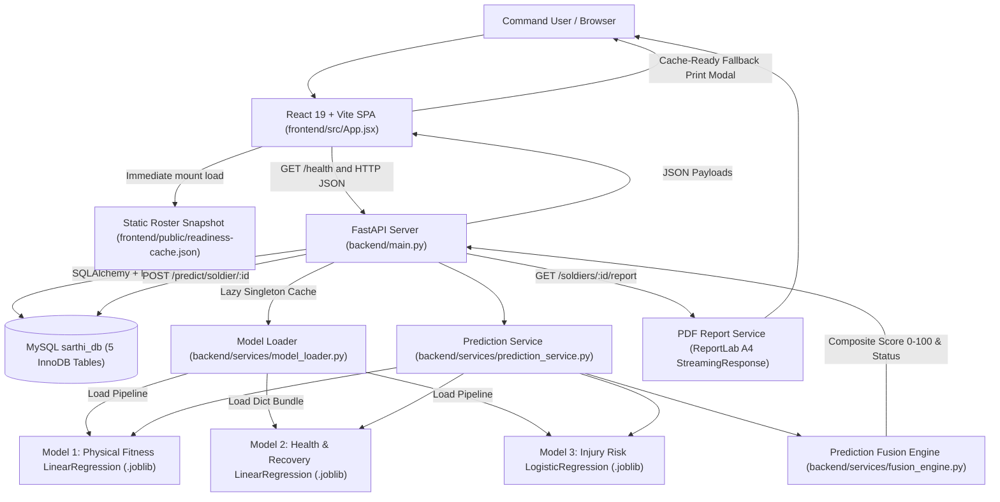
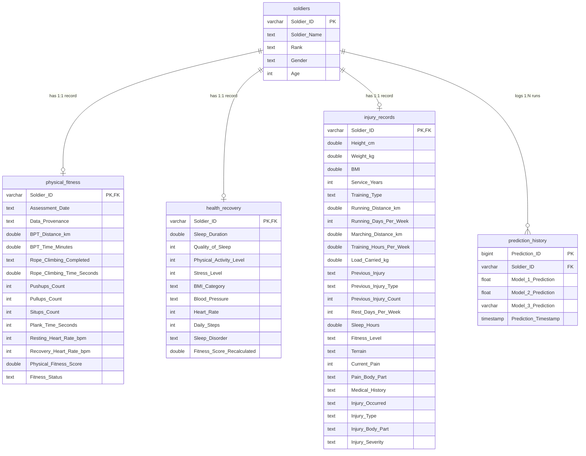
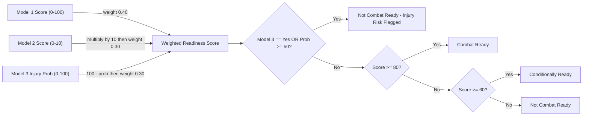

# S.A.R.T.H.I. — System Architecture

This document details the actual runtime, data, machine learning, and report-generation architecture implemented in **S.A.R.T.H.I.** (*Soldier Assessment, Readiness, Training & Health Intelligence* — displayed in UI/PDF headers as *Soldier AI Readiness, Tracking, Health & Intelligence*).

---

## 1. End-to-End Architecture Diagram

---

## 2. Layer-by-Layer Breakdown

### 2.1 Presentation Layer (`frontend/`)

- **Framework & Styling:** Built with **React 19.3.1**, **Vite 8.3.6**, **Tailwind CSS 4.3.5** (`@tailwindcss/vite`), and **Lucide React 1.77.0** icons inside a responsive SPA (`frontend/src/App.jsx`, styled by `frontend/src/index.css`).
- **Hybrid Resilience Pattern (Cache-First + Live Upgrade):**
  1. On application mount (`useEffect`), `App.jsx` fetches `/readiness-cache.json` (`2,000` normalized soldier dossiers generated with actual ML predictions and problem-area rules) so the command portal works immediately even when no backend server is running (`CACHE READY` / `STANDBY` state).
  2. In parallel, it probes `${API_BASE_URL}/health` (timeout `2500ms`, configured via `VITE_API_URL`, defaulting to `http://127.0.0.1:8000`). If reachable, it switches status to `CONNECTED` (`ONLINE`), fetches `${API_BASE_URL}/readiness-directory`, and merges live backend assessments over the cached map.
  3. Searching or inspecting an individual soldier calls `GET /dashboard/{soldier_id}` when connected, falling back gracefully to `recordsMap[targetId]` if unreachable.
- **Navigation Views (`activeNav` state):**
  - `dashboard` (**Overview**): Soldier summary card (ID, Name, Rank, Age, Gender, Historical Injury), SVG circular `ReadinessGauge`, 3 pillar summary cards, `Important Problem Areas`, and `Prediction History` table.
  - `roster` (**Fit / Unfit Soldiers**): Summary filter tiles (`Total`, `Fit`, `Conditionally Ready`, `Unfit`) + live client-side filtering (search query, readiness category, gender, age bracket `<28`, `28–34`, `35+`) and 6-way sorting across all 2,000 soldiers.
  - `fitness` (**Physical Fitness**): BPT result banner, Push-Ups, Pull-Ups, Sit-Ups, and Core Plank metric cards.
  - `health` (**Health & Recovery**): Sleep duration, sleep quality, daily steps, stress level, physical activity level, and resting heart rate tiles.
  - `injury` (**Injury Risk & History**): Injury classification/probability badge, historical injury record, primary load zone, and longitudinal prediction table.
  - `settings` (**Settings & Info**): Theme switcher (`Dark Olive Green Camo` vs. `Stealth Black Dark Mode`), live `Interface Font Size` control (`Small` 14px / `Default` 16px / `Large` 18px saved in `localStorage` key `sarthi_font_size`), Hologram boot replay, and runtime backend metadata.
- **UI Customizations & Visuals:** Includes an animated `IndianArmyEmblem` SVG hologram intro, interactive cursor-tracking `WoodlandCamoBackground`, live sidebar `GRID TRACK` coordinates with `Made by Nishreyash Tripathi` watermark, and a browser print modal (`window.print()`) fallback when `/soldiers/{id}/report` cannot be reached.

### 2.2 API & Orchestration Layer (`backend/main.py`)

- **Runtime:** FastAPI `0.163.1` served by Uvicorn (`backend/Procfile`).
- **CORS Policy:** Configured via `CORSMiddleware` permitting `http://localhost:5173`, `http://127.0.0.1:5173`, `http://localhost:5174`, `http://127.0.0.1:5174`, preset Netlify production origins, plus any comma-separated origins in `ALLOWED_ORIGINS`. `allow_credentials=False`.
- **Input Validation & Security:**
  - No user login, session cookie, or JWT authentication layer is implemented.
  - `POST /predict/fusion` uses Pydantic v2 `FusionRequest` with `ConfigDict(extra="forbid")` and a `@field_validator` requiring non-empty string feature keys.
  - SQL queries use SQLAlchemy `text()` bind parameters (`:soldier_id`, `:model_1`, `:model_2`, `:model_3`); dynamic table formatting iterates strictly over hardcoded whitelists (`["physical_fitness", "health_recovery", "injury_records"]`).
  - `prediction_service.py` enforces exact feature key matching (rejecting missing or unexpected features), non-boolean/non-string numeric checks, and `math.isfinite()` validation before inference.

### 2.3 Database Layer (`backend/database.py` & MySQL `sarthi_db`)

- **Driver & Engine:** SQLAlchemy `create_engine` with `mysql+pymysql` URL construction (`URL.create`) and `pool_pre_ping=True`. Credentials are loaded via `python-dotenv` from `.env` (`DB_HOST`, `DB_PORT`, `DB_NAME`, `DB_USER`, `DB_PASSWORD`).
- **Schema (`sarthi_db` — 5 InnoDB tables):**

> **Note:** When `/dashboard/{soldier_id}` prepares data for `injury_records`, it pops the four ground-truth dataset outcome columns (`Injury_Occurred`, `Injury_Type`, `Injury_Body_Part`, `Injury_Severity`) into `historical_injury_outcome` so historical outcomes remain separated from Model 3 input risk features.

### 2.4 Machine Learning & Fusion Layer (`backend/services/`)

#### Model Inventory (Loaded by `services/model_loader.py`)

| Model Slot | Artifact Path | Estimator / Pipeline | Input Count | Output |
| :--- | :--- | :--- | :---: | :--- |
| **Model 1** (Physical Fitness) | `backend/models/Model_1/sarthi_model1_physical_fitness_v1.joblib` | `sklearn.pipeline.Pipeline` (`ColumnTransformer` with `StandardScaler` on 10 numeric cols + passthrough `Rope_Climbing_Completed` → `LinearRegression`) | 11 | Fitness score (`0–100`) |
| **Model 2** (Health & Recovery) | `backend/models/Model_2/sarthi_model2_fitness_regression.joblib` | Dictionary bundle (`LinearRegression`, `features`, `target="Fitness_Score_Recalculated"`, `test_metrics`: R² `0.999994`, MAE `0.00246`, RMSE `0.00286`) | 7 | Recovery score (`0–10`, marked experimental) |
| **Model 3** (Injury Risk) | `backend/models/Model_3/sarthi_model3_injury_risk.joblib` | `sklearn.pipeline.Pipeline` (`ColumnTransformer`: median impute + `StandardScaler` on 14 numeric cols; most-frequent impute + `OneHotEncoder(handle_unknown="ignore")` on 9 categorical cols → `LogisticRegression(class_weight="balanced", max_iter=2000, random_state=42)`) | 23 | Binary class (`"No"` / `"Yes"`) + probability (`0–100%`) |

> Note: `Model_1/` also contains unused files (`sarthi_model1_activity_v2.joblib` and `sarthi_model1_physical_fitness_v1_corrupt_backup.joblib`) left untouched from earlier experimentation; neither is loaded at runtime.

#### Exact Model Input Features

- **Model 1 (11 features):** `Age`, `BPT_Distance_km`, `BPT_Time_Minutes`, `Rope_Climbing_Completed` (parsed from `"true"/"1"/"yes"` or `"false"/"0"/"no"` to boolean), `Rope_Climbing_Time_Seconds`, `Pushups_Count`, `Pullups_Count`, `Situps_Count`, `Plank_Time_Seconds`, `Resting_Heart_Rate_bpm`, `Recovery_Heart_Rate_bpm`.
- **Model 2 (7 features):** `Age`, `Sleep Duration`, `Quality of Sleep`, `Physical Activity Level`, `Stress Level`, `Heart Rate`, `Daily Steps`.
- **Model 3 (23 features):**
  - *Numeric (14):* `Age`, `Height_cm`, `Weight_kg`, `BMI`, `Service_Years`, `Running_Distance_km`, `Running_Days_Per_Week`, `Marching_Distance_km`, `Training_Hours_Per_Week`, `Load_Carried_kg`, `Previous_Injury_Count`, `Rest_Days_Per_Week`, `Sleep_Hours`, `Current_Pain`.
  - *Categorical (9):* `Rank`, `Gender`, `Training_Type`, `Previous_Injury`, `Previous_Injury_Type`, `Fitness_Level`, `Terrain`, `Pain_Body_Part`, `Medical_History`.

#### Fusion Engine Workflow (`services/fusion_engine.py`)

1. `_run_model` wraps each model call in `try/except`, returning `{"status": "success", "data": ...}` or `{"status": "failed", "error": ...}` so partial model failures are explicitly reported via `fusion_status` (`"completed"`, `"partial_failure"`, `"failed"`).
2. `calculate_readiness` runs only when all 3 models succeed (`successful_models == 3`). It validates domain bounds (`0 <= Model 1 <= 100`, `0 <= Model 2 <= 10`, `0 <= Model 3 Prob <= 100`), scales Model 2 by `10`, computes `injury_safety = 100 - injury_probability`, and calculates `round(0.40 * physical + 0.30 * normalized_health + 0.30 * injury_safety, 2)`.
3. **Rule-based Problem Areas (`GET /dashboard/{soldier_id}`):** Flags `Injury Risk` (`Yes` or `>= 50%`), `Physical Fitness` (`< 50`), `Stress Level` (`>= 7`), and `Sleep Quality` (`<= 6`).

### 2.5 PDF Report Generation (`backend/services/pdf_report_service.py`)

Using **ReportLab `5.1.0`** (`SimpleDocTemplate`, `A4`), `generate_soldier_report(dashboard_data)` renders an in-memory `BytesIO` PDF streamed via `StreamingResponse` (`application/pdf`, `Content-Disposition: attachment; filename="SARTHI_{soldier_id}_Report.pdf"`) containing 9 structured sections:
1. Soldier Profile
2. Physical Fitness Assessment
3. Health and Recovery Assessment
4. Injury and Training Details
5. Historical Injury Outcome (Dataset)
6. Identified Problem Areas
7. Prediction History (new page with paginated repeat-header table)
8. Final Assessment Summary
9. Data Source and Model Limitations (academic research disclaimer)
